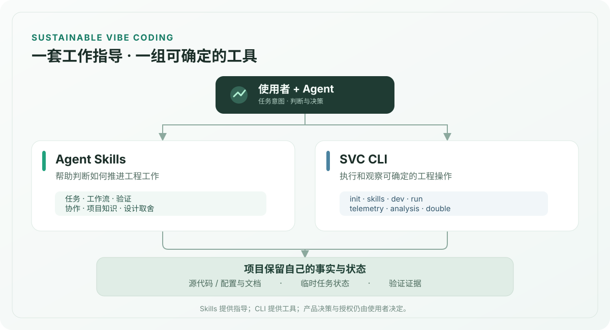

# Sustainable Vibe Coding

**让 AI 辅助开发成为可持续的软件工程。**

Sustainable Vibe Coding（**SVC**）面向与 Coding Agent 共同开发软件的人。它关注代码生成之后依然重要的事情：**任务能否继续、项目事实是否清楚、设计选择有没有依据，以及怎样判断工作真正完成。**

SVC 把工作指导与软件工具分开提供，可以按需要独立采用：

- **Agent Skills**：为任务推进、人机协作、验证、知识维护和设计取舍提供按需加载的工作指导。
- **软件工具**：CLI 提供 Skills 安装与采用、开发资源管理、项目命令执行和 Agent 执行证据分析；原生 macOS App 提供开发资源的图形入口。

[SVC Dev](docs/prd/development.md) 是面向人和 Agent 的开发资源管理能力，围绕资源状态、访问和明确的控制动作展开，不推断开发任务。[macOS 菜单栏 App](macos/README.md) 与 `svc dev` 分别提供图形和程序化入口。App 使用用户安装的兼容 CLI，不自动安装独立环境；找不到时提供 GitHub Releases 与 PyPI 安装入口。两者各自维护版本，通过公开 JSON 协议协作；职责与兼容规则见 [App 与 CLI 合同](docs/product-tdd/macos-client.md)。当前交付仍以项目声明的长驻开发能力为主。

它不规定所有项目必须遵守同一套开发流水线，也不接管项目自己的代码、文档和决策权限。

[快速开始](#快速开始) · [六个-skills](#六个-skills) · [cli-能做什么](#cli-能做什么) · [用户手册](USER_MANUAL.md) · [发布记录](https://github.com/xiaoland/svc/releases)

## 为什么做 SVC？

Coding Agent 让写代码、探索方案和生成文档更容易；但一次任务结束后，真正需要保留下来的工程信息往往仍然散落在对话、临时文件和重复的说明里。下一次工作又要重新理解已有决策，甚至重复验证已经解决的问题。

SVC 尝试把这些负担放回合适的位置：

- **任务状态**留在可恢复、可清理的 Task Packet 中；
- **长期项目事实**由源代码、配置、测试或对应的正式文档维护；
- **验证**围绕具体目标与证据，而非仅凭“测试通过”；
- **重复的机械工作**交给 CLI，语义判断仍由 Agent 与使用者完成。



## 六个 Skills

每个 Skill 都是自包含的目录，可以单独安装。它们按当前任务需要使用，**不会组成一条强制的线性流程**。

| Skill | 解决的问题 |
| --- | --- |
| [`svc-task-packet`](corpus/svc-task-packet/SKILL.md) | 如何保存、恢复和收尾一个非平凡任务的临时工作状态？ |
| [`svc-workflow`](corpus/svc-workflow/SKILL.md) | 如何与使用者协作，在探索、设计、规划和实现之间调整工作方式？ |
| [`svc-verification`](corpus/svc-verification/SKILL.md) | 什么证据足以支持一次修改确实满足目标？ |
| [`svc-agent-collaboration`](corpus/svc-agent-collaboration/SKILL.md) | 什么时候值得交给另一个 Agent，怎样交接并采用结果？ |
| [`svc-specs`](corpus/svc-specs/SKILL.md) | 哪些事实值得长期保存，应该由哪里负责维护？ |
| [`svc-taste`](corpus/svc-taste/SKILL.md) | 面对多个可行设计，怎样按真实代价与后果作取舍？ |

Skills 的完整导航见 [`corpus/index.md`](corpus/index.md)。安装后是否被 Agent 正确发现、加载和使用，仍需在目标宿主中实际检查。

## CLI 能做什么？

CLI 负责可确定的工程操作与观察，不代替 Agent 作产品或技术决策。

| 命令 | 能力 |
| --- | --- |
| `svc init` / `svc status` / `svc skills` | 检查项目集成状态，按计划初始化，并安装、检查与采用 Skills |
| `svc dev` | 观察、确保或停止本机项目声明的开发能力，由项目控制入口决定实际运行位置 |
| `svc run` | 运行项目声明的命名命令，并读取执行记录 |
| `svc telemetry` / `svc analysis` | 从本地 Coding Agent 记录中提取执行证据，并进行结构查询和原始证据回读 |
| `svc double` | 在显式配置的边界场景中运行可复现的外部系统替身（可选功能） |

例如，诊断一次 Coding Agent 执行时，可以先查看可用的本地记录，再导出指定记录进行分析：

```bash
svc telemetry agent-thread list --json
svc telemetry agent-thread export --thread-id <id> --output /path/to/evidence.zip --json
svc analysis query --schema
```

`analysis` 处理的是结构化执行证据；**任务为什么失败、结果是否可接受**，仍需要 Agent 或使用者结合实际目标判断。完整协议和敏感数据注意事项见[用户手册](USER_MANUAL.md#分析-agent-任务证据)。

## 快速开始

### 只使用 Skills

可以通过支持 Agent Skills 的管理器直接安装，例如使用 Vercel Skills 安装 Task Packet：

```bash
npx skills@1.7.0 add xiaoland/svc --skill svc-task-packet --agent codex --copy
```

其他五个 Skill 可按需选择。Claude Code 在该管理器中的宿主名称是 `claude-code`。这条路径不需要先安装 SVC CLI。

> **注意：**把 Skill 安装到目录，并不等于 Agent 一定会使用它。完整采用 SVC 时，还需在项目常驻的 Agent 指令入口中声明必要工作规则；请参见[安装与采用指南](USER_MANUAL.md#安装升级与采用-skills)。

### 使用 CLI

需要项目状态检查、开发环境工具或 Agent 诊断时，可安装独立发行的 CLI（Python 3.11+）：

```bash
python -m pip install sustainable-vibe-coding
svc --help
svc status . --json
```

初始化项目采用**先查看计划、再显式应用**的方式；默认不会覆盖项目现有内容：

```bash
svc init . --json
svc init . --apply <plan-digest>
```

CLI 可以从独立版本的发行物安装 Skills，也可以管理在项目中的采用状态。版本、宿主目录和完整步骤见[用户手册](USER_MANUAL.md#安装升级与采用-skills)。

## 版本与边界

**Skills（Corpus）与 CLI 分别发行、独立升级。** 从 Corpus v16 起，六个 Skills 分别提供 ZIP 发行物；CLI 包本身不携带这些框架正文。项目可以按需要采用特定 Skill 与版本。

SVC 保留使用者已有文件和权限边界：CLI 的受管写操作需要明确应用计划；框架指导不会自动授予修改代码、委派任务或执行外部操作的权限。项目始终拥有自己的正式事实，临时任务记录不自动成为长期规范。

## 项目文档与贡献

- [用户手册](USER_MANUAL.md)：安装、采用、CLI 命令与行为边界
- [框架入口](corpus/index.md)：六个 Skills 与迁移指导
- [贡献指南](CONTRIBUTING.md)：源码工作区、验证和发布
- [安全政策](SECURITY.md)：安全问题的报告方式
- [CLI 变更记录](CLI_CHANGELOG.md) / [Corpus 变更记录](CORPUS_CHANGELOG.md)：独立发行历史

在源码仓库中参与开发，需要 Python 3.11+ 与 PDM 2.28+。构建和检查命令见[贡献指南](CONTRIBUTING.md)，避免与使用者的安装步骤混淆。

原生 macOS 菜单栏面板可统一查阅和控制本机项目声明的开发服务器，构建与使用入口见 [macOS App](macos/README.md)。

本项目采用 [MIT 许可证](LICENSE)。
