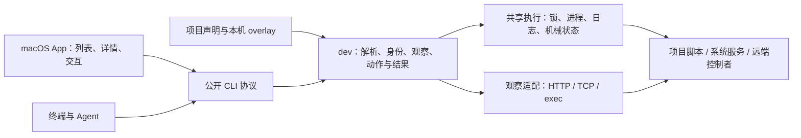

# SVC Dev 已确认技术方案

2026-10-27：本技术方案与随后验收设计均已接受，当前进入获准的第 4 阶段实现准备。本文保留本任务的技术取舍与反例分析；已接受的跨单元合同已进入 [App／CLI 文档](../../docs/product-tdd/macos-client.md#资源合同)，该文档明确区分当前实现和已确认演进。[产品要求](../../docs/prd/development.md) 继续拥有产品基线。方案获准不等于已实现或已验收，具体阶段权限由 Packet 记录，方案获准本身不授权实施。

## 项目外登记的 ROI 与范围修正

此前把 Velune 禁止引入 SVC 的约束直接推成“必须支持项目外登记”，没有评估边际收益与维护成本。四项目调查只证明资源控制方式多样，没有证明使用者反复需要一个独立个人资源目录，也没有操作频率、接入意愿或节省时间的数据，因此无法给出可信的量化 ROI。

| 路线 | 已有收益依据 | 新增成本与限制 | 本轮判断 |
| --- | --- | --- | --- |
| 项目声明复用已有工具 | InKCre 已有项目声明；其它项目的现有脚本证明控制特性，但不表示已同意接入。 | 每个接入项目需提供声明及维护动作事实；不接受接入的项目不纳管。 | 采用。单一来源与项目控制代码更容易一起维护。 |
| 项目外独立登记 | 能让未修改仓库的本机资源进入列表；Velune 是潜在例子，尚无必须接入的需求。 | 另一个配置来源、覆盖优先级、路径搬迁、身份冲突、登记编辑与迁移，以及项目脚本变化后登记信息的维护。 | 不纳入当前方案。保留重新评估的可能，不预建接口或存储。 |
| 只给原 ensure／stop 增加说明 | 能改善现有面板的动作表达。 | 仍无法自然表达仅观察、多状态、安装或连接资源。 | 不足以完成已认可的产品要求。 |

资源运行在项目外与声明放在项目外是两件事。现有 [配置](../../cli/src/svc_cli/config.py) 已支持 `network_scope=remote` 与 host 范围；项目脚本可以调用既有 SSH 或系统控制入口。保留项目声明不限制远端资源，也不要求采用 SVC Skills。当前不建立全局登记库，不把独立“桥接项目”或任意配置路径作为绕过项目约束的接入方案。若以后存在明确、反复的个人跨项目资源目录需求，再以维护次数和实际使用收益重评。

## 推荐结构与责任

在现有 Python `dev` 领域内建立项目内资源模型，继续由公开 CLI 协议承载 App 与终端／Agent 的共同语义，复用私有共享执行层。App 与 CLI 的产品地位不要求分别实现控制引擎；增加 daemon、插件系统或独立资源数据库没有当前需求依据。

| 所有者 | 本方案责任 | 不接管的事实 |
| --- | --- | --- |
| 项目声明与实际控制者 | 资源含义、作用对象、可用动作、影响和完成依据；控制者仍执行实际权限检查。 | 声明描述不成为独立验证的安全保证。 |
| `dev` 领域 | 解释资源和动作、生成身份、观察各方面、校验声明、协调请求、判定可支持的结果。 | 不依据 PID 接管资源，不重写数据库清理、设备签名或业务任务规则。 |
| [`_execution`](../../cli/src/svc_cli/_execution.py) | 进程句柄、执行 ID、生命周期锁、原生日志及机械状态。 | 不增加资源类别、健康或业务完成判断。 |
| App | 项目来源偏好、资源列表与详情、动作选择、刷新和当前会话反馈。 | 不解释配置、不合并动作权限、不扫描私有 runtime 文件。 |

当前 [`_TargetBase`](../../cli/src/svc_cli/config.py) 强制 `probe` 和 `provision`，当前 [`runtime.py`](../../cli/src/svc_cli/dev/runtime.py) 把结果收敛到单一 readiness。继续向 target 填入安装、连接和额外状态字段会保留两套互相牵制的模型。因此选择资源声明替换固定 target 结构，而不是只改名称或新增五个资源子类。

## 声明、身份与共享边界

建议下一配置 schema 使用 `dev.resources`，每个具名资源包含可选显示名、作用范围、控制者说明、访问入口、具名观察项、具名动作和明确关系。观察与动作可以为空，但资源至少提供观察、访问或人工／自动操作中的一项。五类控制特性由接入能力表达；一个动作可同时具有多项控制特性，不按分类分派执行器。

`svc.json` 是完整项目来源，`svc.local.json` 仍是同 schema 的稀疏本机覆盖，不能脱离基础配置单独登记。声明在 CLI 解析成一份不可变的有效资源快照，App 只消费公开投影；配置摘要覆盖动作说明和执行内容，但不把 env 值等私有输入复制到 UI。自动动作继续以 argv、明确 cwd 和环境执行，不由 App 组装 shell 文本。cwd 的工作区约束和远端探测的显式选择继续保留。

身份分为三个互不替代的事实：

- **入口身份**是所选项目／工作树和资源键，负责寻址与说明用户从哪里发起操作。
- **控制协调身份**指向本机命名空间中的一个协调边界。直接资源沿用现有 `scope + scope_id + resource key` 的生成规则；原 `host_key` 含义保留。它用于锁，不证明底层物理实例唯一。
- **观察实例身份**来自控制者或探测证据，未提供时保持未知。URL、PID、显示名和协调身份都不能替代它。

显式共享 owner 引用可以指向另一项目中的一个直接资源声明，且只能是一跳，不允许 owner 引用链或环。CLI 只解析其身份与必要来源，不自动执行其探测、依赖或动作；所选入口的动作仍由所选入口声明，不继承 owner 的动作集合。owner 缺失或配置无效时，共享控制请求失败，不能悄悄退回本地锁；本入口独立的观察和访问仍可返回并标明关联无法解析。普通关系只用于说明，不产生共享锁或启动顺序。

同一 owner 的入口共享协调边界，但不合并权限、动作或就绪状态。App 保留各来源入口并显示明确关联，不做自动去重或动作并集。跨主机、跨用户和组合动作内部的互斥仍由真实控制者承担；本机锁只协调本机 SVC 调用，不能阻止用户直接执行项目脚本。

## 观察合同

观察是具名方面，例如可访问、运行就绪、已安装或已连接。每项结果包含方面键、检查对象、来源、SVC 检查时间、结果与诊断；控制者提供的数据时间和实例身份另列，不能用查询时间覆盖旧数据的时间。配置可声明有效时长，过期结果显示过期并不得作为动作完成条件。没有单一“所有状态均健康”的资源总布尔值。

HTTP／TCP／exec 的现有调用能力继续复用。普通 probe 的成功只证明其声明的条件满足；失败不能自动反转成“资源已停止”。超时、解析错误和不可判定的传输失败表达未知，保留原诊断。明确的 HTTP 非成功响应或 exec 约定返回可以表示条件未满足，但仍不能扩大其业务含义。

exec 观察允许两种明确格式：退出码判定或结构化 JSON。前者约定 0 为条件满足、1 为不满足，其它退出码为观察失败；后者使用版本化小合同返回 `satisfied / unsatisfied / unknown`、可选显示值、说明、数据时间和实例身份，以表达版本等非健康事实。原始 stdout 不能被自动猜成状态对象，也不能被当作指令。

worktree 实例要求只用于必须证明该实例的运行就绪观察；就绪后释放长驻进程必须满足此证明。宿主唯一 App、设备安装或共享服务使用其显式作用范围，不因来源是 worktree 就把所有状态强行绑定到工作树实例。旧探测对端点字符串的校验不能被宣传为比控制者实际提供的证据更强的身份保证。

默认刷新只使用声明为可自动观察的入口；已知会建立连接或触发控制的脚本必须登记为动作。任意项目代码的实际副作用不受 SVC 沙箱保证，接入声明与项目仍是信任边界。单项观察失败不抹去其它方面，也不能隐藏资源已有的可执行动作。

## 动作、完成和中断

动作由稳定键寻址，包含显示意图、控制特性、作用对象、持久数据影响、执行方式与完成合同。数据影响为未改变、可能修改、可能删除或未知；缺失事实保持未知。人工动作返回步骤和可用入口，不伪装成可执行命令。控制者拒绝、动作缺失与效果未知分别表达；未知效果本身不被偷偷转换成额外权限或安全保证。

自动动作选择以下完成方式：

| 方式 | SVC 持有的责任 | 可以报告的结论 |
| --- | --- | --- |
| `exit` | 持有执行与协调锁，直到有限命令退出；可继续检查声明的正向完成条件。 | 命令结束；只有条件满足才能进一步报告预期状态已证实。 |
| `ready` | 启动本次拥有的长驻进程，取得声明的就绪与实例证明后，使用现有 release 机制释放。 | 此次证明成立时就绪；释放后不继续拥有该服务器进程。 |
| `submitted` | 等待控制者的提交命令结束，返回请求事实及可用的控制者操作引用。 | 仅请求已接受，不能报告实际资源操作完成。 |

`submitted` 只适用于实际控制者负责后续身份、冲突处理和生命周期的情况。本地锁保护提交阶段，不保护控制者接手后的整个操作；后续动作的最终许可由控制者判定。没有这种控制合同的脚本必须保持有限命令等待，不能通过提前退出获得异步承诺。操作引用是诊断或后续查询的入口，不引入 SVC 通用后台任务系统。

有限命令选择 `wait` 或 `terminate` 中断策略。`wait` 不设置导致终止的命令期限；动作启动后 SIGINT／SIGTERM 只记录停止等待的请求并继续持锁等真实结果，不转发或升级成强杀。启动前取消则不再启动动作。`terminate` 仅用于声明允许中断的命令，允许明确期限和对本次仍拥有的进程发送信号；不能据此杀死已释放或记录中的历史 PID。`ready` 方式只用于可在未就绪时终止本次拥有进程的服务启动，初始化或排空数据的命令应通过 `exit + wait` 或已有异步控制者表达。

调用等待期限、观察期限和执行终止是不同概念。App 不增加短控制超时；无取消能力的动作不显示“取消成功”，退出 App 继续沿用等待操作完成或取消退出的行为。需要随时脱离客户端的流程应使用已有异步控制者；本方案不承诺 SVC 在 owner 强杀、系统关闭或崩溃后继续可靠托管命令。

回执分别保留请求接受情况、执行事实、完成条件及最终各方面观察。命令成功且 ready 不满足，只能报告该事实，不能泛化成已停止、已销毁或数据已保留。停止需要更强结论时，声明必须提供正向的停止完成检查；不以探测不可达充当该证明。

## 协调、声明变化与未知结果恢复

所有对同一协调身份的控制请求使用同一生命周期锁。默认有限动作执行一次，不缓存复用历史成功；遇到其它控制操作返回 busy，不把删除、更新等请求悄悄排队延迟执行。明确的 ensure 式动作可以声明“达到正向条件”：条件已满足时复用观察，仅对同一入口、同一动作和同一解析意图的在途请求允许 join；其他动作和跨入口调用不推定等价。ensure 不用于表达一次性销毁。

用户查看后再操作时提交所见有效声明摘要。CLI 取得锁后重新解析当前入口、owner 身份和动作，校验摘要及协调键，随后执行同一份验证快照。变化则返回声明已变化并刷新，不改用新动作自动重试；无期望摘要的直接 CLI 调用也必须使用锁内重新解析的快照。intent 包含所选入口、动作键、解析后的 argv／cwd、环境摘要、完成与中断策略及相关声明摘要；相同 argv 不单独构成等价。摘要不固定外部脚本字节、PATH 中的可执行物或控制器内部行为。

join 不取得 owner 持有的锁，因此加入前必须另行核对请求声明与已发布执行的入口、摘要和 intent；只有完全对应的在途执行才能共享结果。等待期间声明变化同样返回刷新，不借用旧执行成功为新声明背书。有限命令的期限不包含另一动作的排队时间，因为本方案不隐式排队这类控制请求。

owner-lost 是真实的未决状态，不只是一次请求失败。现有独立进程可以在 CLI 被强杀后继续运行，而锁已经释放。因此同一协调边界存在未解决的 owner-lost 时，继续允许查询和观察，后续变更均返回冲突，不能在第二次点击就悄悄重新执行。

提供一个有界恢复入口：引用具体 execution ID，明确确认原结果未知、重新操作可能重复，然后解除该边界的阻断。恢复本身不执行动作、不修改原未知结果，也不宣称原进程已结束；使用者可以先通过实际控制者核对。CLI 在锁内校验该 ID 确为当前边界待解决的执行，将确认记录保存在现有 runtime 树的 dev 领域记录中；App 通过同一公开接口呈现恢复。记录不是资源登记库，也不是通用审批系统。新动作要在恢复后另行明确发起。PID 观察不能替代恢复或授予接管权。

## 公开接口与 App

| 入口 | 提案合同 |
| --- | --- |
| `svc dev list [resource] --repo …` | 解析声明与已有执行事实，返回资源、动作、关系及摘要；不运行 provider probe。 |
| `svc dev status [resource] --repo …` | 获取具名观察，返回各项来源、时间、实例与错误；不执行控制动作。 |
| `svc dev act resource action --repo …` | 请求一个明确动作，支持期望声明摘要；返回统一动作回执。 |
| `svc dev ensure resource`／`stop resource` | 仅在存在对应明确动作时调用；ensure 必须满足其收敛语义，stop 不意味着无损停止。不挑选任意第一个动作。 |
| `svc dev reconcile resource --execution ID --acknowledge-unknown` | 只确认并解除指定 owner-lost 的 SVC 阻断，不重跑动作。没有确认参数时只返回未决事实。 |

这些名称是提案接口，当前 CLI 尚不提供新增命令。资源、观察、动作和回执通过同一组严格公开模型投影；App 按 command 与结果 schema 校验，不解析 svc.json。CLI 文本与 JSON 表达同样的区别，不强迫程序化调用经过 App。

退出码不能代替结果对象。list／status 的 0 表示请求成功取得可判定结果，不要求所有资源条件均满足；存在未知或部分观察失败时返回 3 并保留有效项。act 的 0 表示所声明的完成合同成立，submitted 时仍只表示已接受；busy、人工操作、声明过期、条件未满足和未解决 owner-lost 返回 3，配置或执行错误返回 4，真正取消或终止返回 130。wait 模式收到中断请求而最终正常结束时保留真实完成结果，不因为曾收到信号就伪报中断成功。

App 保持项目来源列表，按来源展示资源行；行内呈现相关状态及可用动作，展开详情查看其它方面、实例依据、关系、动作影响与回执。动作分类帮助组织菜单，不建立五套 UI 模板。较强后果在执行前可见，完整 argv 或实现细节不塞进普通操作流程。原来的“就绪数／目标数”不适用于混合资源，改为资源数量及需要关注的状态，而不是为所有资源发明统一健康值。

App 中观察按入口和方面保存，操作按协调身份锁定，回执保留执行 ID 与所选入口；其他别名不借共享 ID 继承动作或反馈对象。刷新继续使用已有 generation 规则防止旧响应覆盖操作后状态。切换 CLI 或项目来源后使对应观察失效。用户设置与项目路径继续由 App 保存，CLI 仍按显式 `--repo` 独立工作。

## 迁移、版本和实际成本

仓库 [CONTRIBUTING](../../CONTRIBUTING.md) 明确配置 current-only。建议下一 schema 将 `dev.targets` 替换为 `dev.resources`，提供人工迁移说明，不建立长期双读、自动写消费者配置或字段别名。资源键、scope 和 host_key 不变的直接迁移保留原协调键，旧在途执行不会因结构改名而获得平行的新锁。既有 `${dev.target}`／`SVC_DEV_TARGET` 作为公开脚本接口保留，明确表示所选资源键；不为内部命名统一强迫所有脚本同时改名。

迁移先只改变声明形状、保持协调身份；再讨论引入 owner、改资源键或改变 scope。后者是协调身份变更，必须在旧边界无活跃或未解决执行时完成。新客户端可从未改变身份的资源查询旧边界状态并处理 owner-lost；不能在改完身份后声称只检查新锁就足够。没有持久身份映射时，不承诺任意热改配置下跨身份互斥。旧客户端会拒绝新 schema，但已启动并持有旧快照的进程仍须完成；升级不能自动停止它们。

原 probe 迁入具名观察，原 provision 迁入具有明确完成方式的 ensure 动作；原 stop 按实际效果迁入 stop 或 destroy 等动作，数据效果未知则保留未知。原超时强杀行为只能在明确选择 `terminate` 的动作中保留，不能原样套给等待型动作。人工及缺失能力按实际声明迁移，不自动补齐。只有已有就绪探测的停止动作可以报告命令与最终探测事实，但不能自动获得“资源已停止”的更强证明。

配置变更会影响 [项目初始化和状态](../../cli/src/svc_cli/project.py)、配置模型及 sparse overlay 校验、dev 入口与公开输出、文档示例和既有配置 fixtures；共享执行事实的新消费者还包括 owner-lost 恢复记录。App 的模型、调用、Store、列表详情及合同测试要与公开协议共同改变。这里说明传播边界，不制定实施步骤。

新旧公开结果不兼容时升级对应结果 schema；配置 current-only 迁移属于破坏性 CLI 行为，需要按最近已发布基线评估 package major。App 继续独立版本，与同源 CLI wheel 配对验收；不因本文档提案提前变更版本或发布。原已安装版本继续可用，实际更新和消费者迁移在后续授权范围内执行。

## 实现准备补足的接缝

[实施计划](plan.md) 已固定 schema 传播、线性顺序与验证入口。准备排演把 dev 的 pending／settled／owner-lost 和回执留在领域记录，保持机械 ExecutionRecord 2；机械退出后的后置条件仍属于未结算阶段，join 等待领域结果。先元数据、再指针、最后启动，以及完整回执与 settled 原子写入，避免崩溃窗口失去阻断。具体合同已同步 [App／CLI 文档](../../docs/product-tdd/macos-client.md#协调与恢复)。

submitted 的动态引用选择独立结果文件，默认退出码仍仅表达接受。迁移须排空旧 owner 及 follower，不能只因同锁就承诺所有旧调用服从新恢复规则。原生实验选择一个窄的 NSButton representable 供资源动作语义寻址，SwiftUI 和 Store 继续拥有界面与状态；保持菜单栏 shell。上述补足不新增产品能力，实验也不代表资源候选已验收。

## 反例审查与方案限制

独立 advisor 已核对模型方向和关键执行接缝；本提案采用了其三个修正：owner-lost 必须阻止后续重复执行；异步提交由控制者承担后续并发；协调身份变更不能绕过旧锁。既有 [`start_isolated / wait_owned / release_owned`](../../cli/src/svc_cli/_execution.py) 能提供机械基础，但现有 stop 的终止路径不能直接复用为等待型动作。没有以专家同意代替实现或运行证据。

本方案可以表达四项目揭示的资源差异，但不承诺四个项目已经接入，也不修改其配置或运行它们。ROI 是依据已知复杂度与现有需求的定性判断，没有伪造收益数字。主要代价是一次明确的配置／输出迁移、资源动作与多方面状态的共同模型，以及为异常 owner 丢失建立可解释的恢复边界。

没有新后台服务、外部登记库、自动发现、自动合并、依赖图执行或通用作业平台。任意脚本行为、跨主机冲突与系统权限仍由真实控制者负责；wait 命令可能长时间占用调用，强杀和崩溃后的实际结果可能未知。后续验收设计需要针对已选合同形成条件、观察和判断规则，本阶段不把那些尚未取得的证据写成通过。
